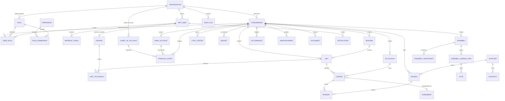

 ✅ |✅ |✅ |✅ |✅ |✅ |✅ |✅ |# Tek Condomínio — Gestão de Condomínios · Arquitetura (Fase 1)

> Documento vivo. Registra a análise de escopo, as decisões técnicas, o modelo de dados e o plano de implementação.
> Premissas adotadas estão marcadas com **[PREMISSA]** e devem ser confirmadas com o negócio.

## 1. Visão do produto

Plataforma SaaS para **administradoras de condomínios** (multiempresa) gerirem cadastros, finanças, cobrança,
inadimplência, assembleias, comunicação, ocorrências, contratos e documentos, com **portal do morador**.
Inspirada na categoria de produto do mercado (ex.: sistemas administradores de condomínio), com arquitetura,
identidade visual e textos originais.

Atores: administrador da plataforma, administrador da administradora, funcionário da administradora,
síndico, subsíndico, conselheiro, funcionário do condomínio, proprietário, morador.

## 2. Requisitos

### 2.1 Funcionais (resumo por módulo)

| # | Módulo | Núcleo |
|---|---|---|
| RF01 | Identidade e acesso | Login, refresh de sessão, logout, recuperação de senha, bloqueio por tentativas, usuários, perfis, permissões por módulo/ação e por condomínio |
| RF02 | Organizações | Cadastro de administradoras (tenant) e do seu primeiro administrador |
| RF03 | Condomínios | CRUD, ativação/inativação com justificativa, dados de contato e endereço |
| RF04 | Estrutura | Blocos/torres, unidades (apto, casa, sala, loja, vaga), fração ideal |
| RF05 | Pessoas | Pessoa única (CPF/CNPJ) com papéis por unidade: proprietário, inquilino, morador, responsável financeiro; histórico de ocupação |
| RF06 | Financeiro | Plano de contas, centros de custo, contas bancárias, lançamentos, transferências, saldo, conciliação, orçamento |
| RF07 | Contas a pagar | Fornecedores, despesas, aprovação, pagamentos parciais, baixa, recorrência, anexos |
| RF08 | Cobrança | Rateio (fração ideal, igualitário, fixo, consumo), geração mensal, multa/juros/correção configuráveis, baixa, estorno |
| RF09 | Inadimplência | Títulos vencidos, acordos/parcelamentos, histórico de contatos |
| RF10 | Assembleias | Pauta, convocação, presença, procurações, votações, atas, deliberações com responsáveis e prazos |
| RF11 | Comunicação | Comunicados segmentados, templates, notificações, canais plugáveis (e-mail etc.) |
| RF12 | Ocorrências | Categorias, prioridade, SLA, interações, anexos, indicadores |
| RF13 | Contratos | Vigência, reajustes, alertas de vencimento |
| RF14 | Documentos | Repositório com controle de acesso, validação, URLs não previsíveis |
| RF15 | Relatórios | Filtros, exportação PDF/Excel/CSV, respeitando permissões |
| RF16 | Dashboard | Indicadores calculados a partir dos dados persistidos |
| RF17 | Portal do morador | Visão restrita à(s) unidade(s) da pessoa |
| RF18 | Auditoria | Trilha de ações críticas sem segredos |

### 2.2 Não funcionais

- **Isolamento multiempresa**: nenhum dado de uma administradora pode ser lido/alterado por outra.
- **Segurança**: OWASP ASVS nível 2 como referência; autorização sempre no backend.
- **Integridade financeira**: transações ACID, `BigDecimal`/`numeric(15,2)`, bloqueio otimista (`version`), sem exclusão física de lançamentos contabilizados (estorno com justificativa).
- **LGPD**: minimização de dados, finalidade, trilha de auditoria, retenção configurável, atendimento a titulares.
- **Desempenho**: listas paginadas no servidor; índices por `organization_id` + filtros comuns.
- **Observabilidade**: logs JSON estruturados com `traceId`, `userId`, `organizationId`; Actuator (health).
- **Usabilidade**: pt-BR, responsivo, acessível (teclado, contraste, rótulos ARIA).
- **Manutenibilidade**: monólito modular, testes automatizados, migrações versionadas.

## 3. Regras de negócio a confirmar (premissas adotadas)

| # | Tema | Premissa adotada (configurável) |
|---|---|---|
| P01 | Multa por atraso | **[PREMISSA]** Até 2% sobre o débito (CC art. 1.336 §1º). Percentual parametrizado por condomínio, limitado a 2% na validação. |
| P02 | Juros moratórios | **[PREMISSA]** 1% a.m. pro rata die quando a convenção não dispuser diferente; percentual configurável por condomínio. |
| P03 | Correção monetária | **[PREMISSA]** Índice configurável (IPCA, IGP-M ou nenhum); valores de índice informados manualmente até haver integração. |
| P04 | Rateio | Critérios: fração ideal, igualitário, valor fixo por unidade, consumo. Diferença de arredondamento atribuída à unidade de maior fração (ou primeira por ordenação) para fechar o total exato. |
| P05 | Arredondamento | `HALF_EVEN` em cálculos intermediários com escala 10; valores finais em 2 casas `HALF_UP`. |
| P06 | Fração ideal | Soma das frações das unidades ativas deve totalizar 100% (ou 1,0) para habilitar rateio por fração. |
| P07 | Inativação | Condomínio inativo não recebe novos lançamentos/cobranças; histórico permanece consultável. |
| P08 | CNPJ | Aceita formato numérico e **alfanumérico** (vigente desde jul/2026, IN RFB 2.229/2024). CNPJ de condomínio é opcional (alguns não possuem), mas único por administradora quando informado. |
| P09 | Bloqueio de login | 5 tentativas falhas → bloqueio de 15 min (configurável). |
| P10 | Sessão | Access token JWT de 15 min; refresh token rotativo de 7 dias em cookie HttpOnly. |
| P11 | Votação | Peso do voto por unidade (1 voto) ou por fração ideal, conforme a assembleia. Procuração registrada por unidade. |
| P12 | Retenção | Registros financeiros e atas: retenção mínima de 10 anos **[PREMISSA]**; dados de moradores sem vínculo: anonimização após prazo configurável. |
| P13 | Administrador da plataforma | Gerencia organizações, **não** acessa dados operacionais das administradoras sem um papel explícito nelas. |

## 4. Arquitetura

### 4.1 Visão geral

```
[Angular SPA] --HTTPS--> [nginx] --/api--> [Spring Boot (monólito modular)] --> [PostgreSQL 16]
                                                 |--> armazenamento de arquivos (disco/S3, via interface)
                                                 |--> provedores externos (boletos, PIX, e-mail) via adaptadores
```

- **Monólito modular**: um único deployable, módulos com fronteiras explícitas por pacote. Comunicação entre módulos
  por serviços públicos do módulo (nunca acessando repositórios de outro módulo diretamente).
- **Mesmo domínio (same-origin)** em produção: o nginx serve o SPA e faz proxy de `/api`, eliminando CORS e
  permitindo cookie `SameSite=Strict` para o refresh token.

### 4.2 Stack e decisões técnicas

| Camada | Escolha | Justificativa |
|---|---|---|
| Linguagem | Java 21 LTS | LTS, records, pattern matching, virtual threads |
| Framework | Spring Boot **3.5.x** | Linha 3.x exigida; 3.5 é a última e mais madura da linha |
| Segurança | Spring Security + OAuth2 Resource Server (Nimbus JOSE) | Validação de JWT nativa do Spring, sem biblioteca extra (dispensa jjwt) |
| Persistência | Spring Data JPA / Hibernate 6, Flyway | Exigidos; Flyway com `ddl-auto=validate` |
| Banco | PostgreSQL 16 | Exigido; `numeric`, `jsonb`, índices parciais |
| API docs | springdoc-openapi 2.8 | Swagger UI em `/swagger-ui.html` |
| Mapeamento | Mappers manuais (classes `*Mapper`) | Explícitos, sem geração de código; poucas entidades por módulo |
| Testes | JUnit 5, Mockito, Spring Boot Test, **embedded-postgres (zonky)** | Testes de integração contra PostgreSQL **real** sem depender de Docker; Testcontainers pode substituir quando Docker estiver disponível |
| Frontend | Angular 22 (standalone, signals), Angular Material, Reactive Forms, RxJS | Exigidos |
| Logs | Logback com encoder JSON estruturado (Spring Boot 3.4+) | Sem dependência adicional |

### 4.3 Organização do backend

```
br.com.tekcondo
├── comum/                  # infraestrutura transversal
│   ├── config/             # OpenAPI, Jackson, propriedades
│   ├── security/           # SecurityConfig, JWT, filtros, UsuarioAtual
│   ├── exception/          # GlobalExceptionHandler (RFC 9457 ProblemDetail), ApiException
│   ├── web/                # PaginaResponse, PaginaRequests (paginação e ordenação)
│   ├── persistence/        # AuditableEntity
│   ├── io/                 # leitura de CSV
│   └── validation/         # validadores de CPF/CNPJ/CEP
├── acesso/                 # login, usuários, papéis, refresh tokens; autorizacao/ (AcessoService, Permissao)
├── administradora/         # tenants (administradoras)
├── auditoria/              # trilha de auditoria
├── notificacao/            # notificações internas
├── integracao/             # banco (CNAB/OFX), e-mail, armazenamento de arquivos
├── condominio/             # condomínios
├── estrutura/              # blocos e unidades
├── pessoa/                 # pessoas e vínculos com unidades
├── financeiro/             # lançamentos, baixas, plano de contas, tesouraria, orçamento, fechamento, extratos
├── indicador/              # indicadores e projeção de caixa
├── cobranca/               # rateios, inadimplência, acordos, retorno bancário
├── fornecedor/             # fornecedores e contratos
├── comunicado/  assembleia/  documento/  ocorrencia/  reserva/  portaria/
├── relatorio/  painel/  portal/
└── rotina/                 # jobs agendados (lembretes diários, retenção de dados pessoais)
```

Nomes de pacotes, classes, rotas e campos seguem o padrão em português descrito em [GLOSSARIO.md](GLOSSARIO.md);
tabelas e colunas do banco continuam com os nomes originais, mapeados explicitamente nas entidades.

Cada módulo de negócio segue: `controller` → `service` → `repository`, com `entity`, `dto` e `mapper`.
Regras de negócio ficam **somente** nos services/entidades; controllers apenas traduzem HTTP.

### 4.4 Multiempresa (isolamento)

1. **Coluna `organization_id`** em todas as entidades de negócio (modelo *shared schema*).
2. O `organization_id` vem **exclusivamente do token** (claim assinada), nunca de parâmetro do frontend.
3. Todo repositório de negócio expõe consultas com `organization_id` obrigatório (`findByIdAndOrganizationId`).
   Um registro de outra organização resulta em **404** (não revela existência).
4. **Integridade no banco**: `UNIQUE (id, organization_id)` nas tabelas‑pai e **FKs compostas**
   `(condominium_id, organization_id)` nas filhas — impossível vincular registro a pai de outra organização.
5. Testes de integração dedicados (`TenantIsolationIT`) comprovam o isolamento.
6. Evolução: Row-Level Security do PostgreSQL como segunda barreira (planejado, Fase 7).

### 4.5 Autenticação e autorização

- `POST /api/v1/auth/login` → access token JWT (HS256, 15 min) no corpo + refresh token opaco em cookie
  `HttpOnly; SameSite=Strict; Path=/api/v1/auth` (Secure em produção).
- Refresh token guardado apenas como **hash SHA-256**; rotação a cada uso; reutilização de token já rotacionado
  revoga todas as sessões do usuário.
- Access token fica **em memória** no SPA (não em localStorage) → reduz impacto de XSS.
- CSRF: a API usa `Authorization: Bearer` (não enviado automaticamente pelo navegador); o único endpoint por
  cookie (`/auth/refresh`) é protegido por `SameSite=Strict` + verificação de `Origin`.
- **Permissões** (enum `Permissao`, códigos `MODULO_ACAO`) agrupadas em **papéis** (`role`). A atribuição
  (`user_role`) tem escopo **organização inteira** (`condominium_id` nulo) ou **um condomínio**.
  Uma mesma pessoa pode ser síndica em um condomínio e moradora em outro.
- Permissões são carregadas do banco a cada requisição (não ficam no token) → revogação imediata.
- `AcessoService.exigir(permissao, idCondominio)` em todo service; listas usam `EscopoAcesso`
  (organização inteira ou conjunto de condomínios permitidos).

### 4.6 Padrões de API

- Versionamento em URL `/api/v1/...`; JSON; datas ISO‑8601; dinheiro como string decimal.
- Paginação: `?pagina=0&tamanho=20&ordem=nome,asc` (campos de ordenação em lista branca) → `PaginaResponse`
  (`conteudo`, `pagina`, `tamanho`, `totalElementos`, `totalPaginas`).
- Erros: `application/problem+json` (RFC 9457) com `codigo`, `detail` em pt‑BR e `erros[]` (`campo`, `mensagem`).
- Concorrência: `versao` no corpo do `PUT`; conflito → **409**.
- Códigos: 200/201/204, 400 validação, 401 não autenticado, 403 sem permissão, 404 inexistente/fora do tenant,
  409 conflito/duplicidade, 422 regra de negócio, 423 conta bloqueada, 429 excesso de tentativas.

### 4.7 Frontend

```
src/app
├── core/        # auth (service, guards, interceptor), contexto (condomínio selecionado), notificacao (erro.interceptor,
│                # sino), layout (shell, tema, tabelas responsivas)
├── comum/       # componentes reutilizáveis (confirmacao-dialog, estado-vazio, cabecalho-pagina), máscaras, rótulos
└── features/    # um diretório por módulo (condominios, administradoras, financeiro, ...), rotas lazy
```

Validações no frontend são apenas de **formato/UX**; a regra de negócio é sempre decidida pelo backend.

## 5. Modelo de dados

Convenções: PK `uuid`; `created_at/updated_at timestamptz`; `created_by/updated_by uuid`; `version bigint`
(bloqueio otimista); valores monetários `numeric(15,2)`; exclusão lógica via `status`/`active` + datas;
nomes de tabela no singular em inglês.



### 5.1 Entidades principais e restrições

| Entidade | Campos-chave | Restrições |
|---|---|---|
| `organization` | name, cnpj, active | `UNIQUE(cnpj)` |
| `app_user` | organization_id (nulo só p/ admin da plataforma), email, password_hash, platform_admin, failed_login_attempts, locked_until | `UNIQUE(lower(email))`; `CHECK(platform_admin OR organization_id IS NOT NULL)` |
| `permission` | code (PK), module, action | catálogo fixo versionado em migração |
| `role` | organization_id (nulo = papel do sistema), code, name | `UNIQUE(coalesce(organization_id), code)` |
| `user_role` | user_id, role_id, organization_id, condominium_id (nulo = toda a organização) | FK composta `(condominium_id, organization_id)`; unicidade da atribuição |
| `refresh_token` | user_id, token_hash, expires_at, revoked_at | `UNIQUE(token_hash)` |
| `condominium` | organization_id, name, legal_name, cnpj, type, endereço, contato, status | `UNIQUE(id, organization_id)`; `UNIQUE(organization_id, cnpj) WHERE cnpj IS NOT NULL` |
| `building` | condominium_id, name | `UNIQUE(condominium_id, lower(name))` |
| `unit` | condominium_id, building_id, identifier, type, ideal_fraction `numeric(9,6)` | `UNIQUE(condominium_id, building_id, identifier)` |
| `person` | organization_id, name, document (CPF/CNPJ), contatos | `UNIQUE(organization_id, document)` — uma pessoa, vários papéis |
| `unit_occupancy` | unit_id, person_id, kind (OWNER/TENANT/RESIDENT), financial_responsible, start_date, end_date | histórico (não sobrescreve) |
| `chart_of_account` | organization_id, code, name, nature (RECEITA/DESPESA), parent_id | hierárquico; `UNIQUE(organization_id, code)` |
| `financial_entry` | condominium_id, bank_account_id, account_id, cost_center_id, amount, kind, competence, status, reversal_of | sem DELETE físico após contabilizado; estorno referencia o original |
| `charge` | unit_id, allocation_id, due_date, amount, fine/interest params snapshot, status | `UNIQUE(unit_id, allocation_id)` evita cobrança duplicada |
| `payment` | charge_id ou payable_id, paid_at, amount, reversed_at, reversal_reason | estorno lógico |
| `audit_log` | organization_id, user_id, action, entity_type, entity_id, details `jsonb`, ip, occurred_at | somente inserção |

## 6. Módulos e dependências

```
identity ─┬─> organization
          └─> condominium (escopo de papéis)
audit <── todos
condominium ─> structure (blocos/unidades) ─> people (ocupações)
finance(plano de contas, centros, contas bancárias, lançamentos) ─> condominium
payables ─> finance + suppliers
billing(rateio, cobrança, pagamentos) ─> structure + people + finance
delinquency ─> billing
assemblies ─> structure + people + documents
communication ─> structure + people + notifications
occurrences, contracts, documents ─> condominium (+ suppliers)
reports, dashboard ─> leitura dos módulos acima
resident-portal ─> people + billing + communication + documents
```

## 7. Plano de implementação

| Etapa | Entrega | Status |
|---|---|---|
| 1 | Fase 1 — este documento | ✅ |
| 2 | Estrutura backend/frontend, Flyway, perfis, OpenAPI, Docker Compose | ✅ |
| 3 | **Primeira funcionalidade E2E**: autenticação + organizações + condomínios + permissões + auditoria + isolamento | ✅ |
| 4 | Usuários e atribuição de papéis (UI de gestão), recuperação de senha | ✅ |
| 5 | Blocos, unidades, fração ideal; seletor de condomínio atual | ✅ |
| 6 | Pessoas, ocupações, importação por planilha | ✅ |
| 7 | Financeiro: plano de contas → centros de custo → contas bancárias → lançamentos/estornos → transferências | ✅ |
| 8 | Contas a pagar/receber, fornecedores, aprovação | ✅ |
| 9 | Rateio e cobrança (multa/juros configuráveis), baixa/estorno | ✅ (registro bancário de boleto/PIX pendente — exige homologação) |
| 10 | Inadimplência e acordos | ✅ |
| 11 | Dashboard e relatórios (PDF/Excel/CSV) | ✅ |
| 12 | Assembleias, ocorrências, contratos, documentos, comunicação | ✅ |
| 13 | Portal do morador | ✅ |
| 14 | Qualidade e implantação: RLS, rate limit por IP, backups, hardening | 🟡 backups ✅; rate limit na autenticação ✅; RLS pendente |
| 15 | Benchmarking e lacunas: fechamento mensal, OFX, retorno CNAB 240, reservas, portaria, indicadores (ver MATRIZ-COMPARATIVA.md) | ✅ |

O acompanhamento detalhado está em [`PROGRESSO.md`](PROGRESSO.md).
